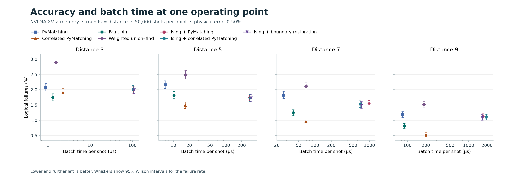

# Syndrome Hunters surface-code decoders

The `shahi_cp` branch includes a packed correlated PyMatching decoder, a separate Sparse Blossom C++ build, and a benchmark through distance 11. [Fast correlated PyMatching results and instructions](results/fast_correlated_pymatching/README.md)

## NVIDIA Ising hybrid experiment

We built a surface-code decoder that restores measured boundary checks after NVIDIA's pretrained Fast R9 predecoder, then applies correlated PyMatching. The CNN predicts local corrections and a logical frame. The matcher decodes the residual syndrome, and the decoder XORs the two logical predictions. The two reference hybrids use the published residual with either ordinary or correlated matching. [Implementation](src/decoders/ising.py) · [Architecture, installation and exact commands](docs/ising.md)

**At distance 3 and 0.1% physical noise, the compiled hybrid beat correlated PyMatching on both logical accuracy and warmed runtime.** On 100,000 fresh Z-memory shots it made **94 errors (0.094%)** versus **137 (0.137%)**, with 68 paired shots favoring the hybrid and 25 favoring correlated matching (p = 0.00000938). The 2 MiB CPU lookup took **0.094 µs/shot** in batches of 64 versus **0.600 µs/shot** for correlated matching. Their single-call medians were 3.2 µs and 11.8 µs. The lookup reproduced every prediction of the streaming GPU hybrid. FaultJoin had the lowest observed failure count in this comparison, with 88. [Held-out measurements](results/ising/lookup-holdout/bench_20261122T002805003139Z.csv) · [Accuracy versus warmed runtime](figures/ising-lookup/accuracy_runtime.png)

The lookup precomputes one million possible syndromes from the circuit and the pretrained model. It took **164.18 seconds** to build on the GPU. Including initialization and warm-up, the first 100,000-shot pass took **164.36 s** versus **0.062 s** for correlated matching. This optimization applies to the distance-3 circuit's 20 independent detector bits. Larger distances use streaming inference. [Compiler](src/decoders/ising_table.py) · [Timing breakdown](results/ising/lookup-holdout/bench_20261122T002805003139Z.json)

At distance 9 and 0.5% physical noise, correlated PyMatching had the lowest error rate and decoded 4,996 shots/s. The boundary-restored hybrid removed 92.2% of detector events, but predicted 545 logical flips incorrectly and decoded 598 shots/s. At distance 3 and 0.1% noise, all three streaming hybrids missed 52 of 50,000 shots, compared with 85 for correlated matching. For the boundary-restored variant, 49 shots favored the hybrid and 16 favored correlated matching (paired p = 0.0000508). FaultJoin had 44 failures at this point. [Final CSV](results/ising/hybrid-final/bench_20261122T001433622270Z.csv) · [Run manifest](results/ising/hybrid-final/bench_20261122T001433622270Z.json)

The final Z-memory grid used **one million shared shots** across four distances and five noise levels. We used NVIDIA's XV circuit and 25-channel noise family after auditing differences in detector ordering, schedule and logical observables in the legacy circuit. Each entrant saw the same 50,000 detector rows per point, with labels held back for scoring. The laptop ran Fast R9 in fp32 on its GTX 1650 Ti and the classical matchers on its Core i7-10750H. Distances below 9 are exploratory for this model. [Circuit audit](results/ising/circuit_audit.json) · [Hardware and checkpoint](results/ising/environment.json) · [Fast R9 model card](https://huggingface.co/nvidia/Ising-Decoder-SurfaceCode-1-Fast)

At **0.5% physical noise**, each cell gives **logical error rate / batch time in µs per shot**. Every decoder used batches of 64, one warmed pass, and rounds equal to distance. Single-shot p50/p95, startup, synchronized inference, matching time, density, memory and 95% Wilson intervals are in the manifest.

| Decoder | Distance 3 | Distance 5 | Distance 7 | Distance 9 |
|---|---:|---:|---:|---:|
| Ordinary PyMatching | 2.074% / 0.88 | 2.164% / 6.98 | 1.826% / 26.56 | 1.188% / 83.36 |
| Correlated PyMatching | 1.910% / 2.25 | **1.488%** / 16.83 | **0.960%** / 68.46 | **0.530%** / 200.16 |
| FaultJoin | **1.750%** / 1.29 | 1.820% / 10.28 | 1.248% / 39.87 | 0.816% / 89.04 |
| Weighted union–find | 2.888% / 1.53 | 2.488% / 17.05 | 2.118% / 68.74 | 1.512% / 185.43 |
| Ising + ordinary PyMatching | 1.990% / 105.79 | 1.738% / 279.24 | 1.540% / 982.83 | 1.136% / 1,715.24 |
| Ising + correlated PyMatching | 2.014% / 104.66 | 1.730% / 289.53 | 1.528% / 675.31 | 1.102% / 1,954.11 |
| Ising + boundary restoration + correlated PyMatching | 1.996% / 109.87 | 1.734% / 302.65 | 1.498% / 711.50 | 1.090% / 1,673.00 |



[LER across physical noise levels](figures/ising-hybrid/logical_error_rates.png) · [LER across distances](figures/ising-hybrid/logical_error_by_distance.png) · [Batch and single-shot runtime](figures/ising-hybrid/runtime_scaling.png) · [Syndrome density and event removal](figures/ising-hybrid/syndrome_density.png) · [10,000-shot preliminary grid](results/ising/hybrid-preliminary/bench_20261121T233047900726Z.csv)

### Run the hybrid locally

From a fresh Windows checkout, install the inference dependencies in their own Python 3.12 environment. On this laptop, that environment and the verified model are already present.

```powershell
py -3.12 -m venv .venv-ising
$py = ".\.venv-ising\Scripts\python.exe"
git clone https://github.com/NVIDIA/Ising-Decoding.git external/Ising-Decoding
git -C external/Ising-Decoding checkout --detach 4e5ef40494d13842aeee6cdf735b4d3134286dfa
& $py -m pip install --index-url https://download.pytorch.org/whl/cu128 torch==2.9.1
& $py -m pip install -c requirements-ising-constraints.txt -r external/Ising-Decoding/code/requirements_public_inference.txt -e ".[dev]" huggingface_hub
& $py -m src.ising_data download
& $py -m src.ising_data doctor
& $py -m pytest -q
```

To reproduce the independent distance-3 comparison, run this from the repository root. The full grid, figure-generation commands, CPU fallback and model-access instructions are in the experiment guide. [Reproduction guide](docs/ising.md)

```powershell
$py = ".\.venv-ising\Scripts\python.exe"
& $py -m src.evaluate --source nvidia --decoders pymatching pymatching_correlated fault_join ising_boundary_correlated ising_boundary_table --distances 3 --ps 0.001 --shots 100000 --seed 20261123 --batch-size 64 --device cuda --precision fp32 --repeats 3 --latency-shots 128 --out-dir results/ising/lookup-holdout
```

## FaultJoin on the original Stim circuit

**FaultJoin is our handwritten surface-code decoder.** Given the detectors that fired in a memory experiment, it predicts whether the stored logical qubit flipped. It uses whole circuit faults to vote on sparse syndromes and uses evidence from correlated detector clicks to decode denser syndromes. Stim generates the circuits and Monte Carlo shots. PyMatching supplies two independent benchmarks.

At distance 3 and 0.5% physical noise, FaultJoin made **799 errors in 50,000 shots**, with a **4.25 µs median single-shot call**. Standard PyMatching made 860 errors with a 13.1 µs median call. At distance 7, FaultJoin also made fewer errors than standard matching, but took longer. [Benchmark data](results/bench_20261121T205718478691Z.csv)


## Measured results

Each cell gives **logical failure rate / batch time per shot** for rotated Z memory at 0.5% physical noise, with one round of syndrome extraction per unit of code distance.

| Distance | FaultJoin | Standard PyMatching | Correlated PyMatching | Handwritten union–find |
|---:|---:|---:|---:|---:|
| 3 | **1.598% / 0.636 µs** | 1.720% / 0.729 µs | 1.646% / 1.717 µs | 1.834% / 1.156 µs |
| 5 | **1.316% / 6.944 µs** | 1.384% / 5.141 µs | 1.042% / 10.549 µs | 1.556% / 11.533 µs |
| 7 | **0.892% / 23.049 µs** | 1.030% / 13.282 µs | 0.600% / 35.519 µs | 1.304% / 43.801 µs |

At distance 7, FaultJoin correctly decoded 262 shots that standard matching missed. Standard matching correctly decoded 193 that FaultJoin missed. Correlated PyMatching achieved the lowest error rate at distances 5 and 7 at this noise level. At distance 7 its median single call took 47.0 µs, compared with 31.9 µs for FaultJoin and 24.35 µs for standard PyMatching. [Runtime and p95 latency figure](figures/runtime_scaling.png)

The Z sweep used 50,000 shots at each of 15 combinations of distance and physical noise. For FaultJoin, distance 7 had fewer failures than distance 5 at 0.7% noise and more at 1.0%. This brackets their finite-distance crossing. An asymptotic threshold would require larger distances and a finer sweep. A separate X-memory run at 0.5% noise used 20,000 shots per distance. At distance 7 it gave 195 FaultJoin failures, 275 standard matching failures and 137 correlated matching failures. [Noise-sweep figure with 95% intervals](figures/logical_error_rates.png) · [X-memory results](results/bench_20261121T205500869314Z.csv)

## How FaultJoin works

1. **Read whole faults.** Each Stim detector error model instruction gives a fault probability, the detectors it toggles and the logical bits it flips. A separator suggests graph edges for the same physical event. FaultJoin retains both the complete event and those edges. [Stim detector error model specification](https://github.com/quantumlib/Stim/blob/main/doc/file_format_dem_detector_error_model.md)
2. **Vote on a sparse syndrome.** Let the odds of fault `i` be `rᵢ = pᵢ / (1 − pᵢ)`. A matching single fault contributes `rᵢ` to its logical class. A pair whose detector sets XOR to the observed syndrome contributes `rᵢ rⱼ` to its combined class. The class with the greatest total wins. This is the exact vote restricted to zero, one or two effective faults. Small models tabulate these votes once. On larger models the decoder chooses a fired detector with few incident faults. Exactly one fault in a matching pair contains that detector, so an indexed lookup finds the other fault and counts each pair once. [Vote implementation](src/decoders/join.py)
3. **Condition edge costs when the vote has no explanation.** For each projected edge and a disjoint partner from the same physical fault, compute the probability that the edge toggled given that the partner's detectors fired. This uses the independent DEM probabilities and the identity `E[(−1)^parity] = ∏(1 − 2pᵢ)`. During decoding, the strongest visible partner discount sets the edge's growth cost. Choosing one discount and quantizing the costs are approximations. Detectors outside logical-carrying components can still provide evidence. [Conditional probability calculation](src/decoders/condition.py)
4. **Complete the correction globally.** Odd clusters grow simultaneously and merge when an edge fills. XOR labels on the union–find forest give the predicted logical flip when every cluster is even or reaches a boundary. The plain union–find comparator runs the same handwritten kernel with fixed edge costs. Both kernels run on the CPU with Numba. [Cluster implementation](src/decoders/union_find.py) · [Delfosse and Nickerson's union–find decoder](https://arxiv.org/abs/1709.06218)

For a small example, suppose a single fault explains a click at detector 0 with logical flip odds of 0.00402. Two different fault pairs can explain that same click without a logical flip, each with odds of 0.00277. Their combined weight of 0.00554 wins the vote. The tests verify this decision by enumerating the underlying Bernoulli events, including the cancelled detector in each pair. [Exact-enumeration tests](tests/test_fault_join.py)

The project contribution is the sparse logical vote combined with partner-conditioned cluster growth. Correlation-aware decoding has established precedents, including belief-matching and belief-find. [Higgott et al.](https://arxiv.org/abs/2203.04948) · [PyMatching and its correlated decoder](https://github.com/oscarhiggott/PyMatching)

## Run it

The reported runs used Python 3.12.10. On Windows, from the repository root:

```powershell
py -3.12 -m venv .venv
.\.venv\Scripts\Activate.ps1
python -m pip install -e ".[dev]"
python -m pytest -q
```

On Linux or macOS, create the environment with `python3.12 -m venv .venv` and activate it with `source .venv/bin/activate`. The same installation and test commands apply.

To reproduce the published grid and figures:

```sh
python -m src.evaluate --basis z --distances 3 5 7 --ps 0.001 0.003 0.005 0.007 0.01 --shots 50000 --seed 20261121
python -m src.plots
```

To reproduce the X-memory check:

```sh
python -m src.evaluate --basis x --distances 3 5 7 --ps 0.005 --shots 20000 --seed 20261122
```

`make test`, `make data`, `make bench SHOTS=50000` and `make plots` are also available. `python -m src.data` writes bit-packed sample archives. Pass the same sampling options to `src.evaluate` with `--data-dir data` to score those saved shots. Each benchmark writes a new timestamped CSV and a JSON manifest. To plot a particular run, pass its CSV path to `python -m src.plots`. Use `--out-dir` to keep a separate figure set.

## Judge interface

Construct one decoder per circuit or noise model and reuse it across shots.

```python
from src.circuits import surface_code_circuit, detector_error_model
from src.decoders.experimental import FaultJoinDecoder

circuit = surface_code_circuit(distance=5, p=0.005, rounds=5, basis="z")
decoder = FaultJoinDecoder(detector_error_model(circuit))
dets, truth = circuit.compile_detector_sampler(seed=12).sample(1000, separate_observables=True)
predicted = decoder.decode_batch(dets)   # bool array (shots, logical observables)
error_rate = (predicted != truth).any(axis=1).mean()
```

For blind evaluation, supply a decomposed Stim `.dem` file and detector-only shots in Stim's little-endian `b8` format. The command writes one packed row of predicted logical flips per shot. The decoder also accepts a single unpacked syndrome through `decode(syndrome)`. [Decoder entry point](src/decoders/experimental.py)

```sh
python -m src.decode --dem code.dem --dets heldout.b8 --out predictions.b8
```

## Measurement details

Stim applies the same physical probability to post-Clifford depolarization, post-reset flips, pre-measurement flips and per-round data depolarization. A shot fails if any predicted logical observable differs from Stim's sampled truth. All four decoders receive identical detector shots at each point. The CSV records a sample checksum, raw failure counts, 95% Wilson intervals, paired disagreement counts and an exact two-sided binomial test on disagreements against standard matching.

Timing used an Intel Core i7-10750H on Windows 11. Batch time is the median of three warmed serial passes with up to 4,096 shots per call. Single-call p50 and p95 use 256 shots. Setup and warm-up have separate CSV columns. Memory is the Python-traced peak during a separate warm batch and can omit native allocations. Stim seeds should be compared on the same version, sampling call shape and CPU instruction set. [Z-run environment and settings](results/bench_20261121T205718478691Z.json) · [X-run environment and settings](results/bench_20261121T205500869314Z.json)

Two earlier runs used independent seeds and measured single calls through the original batch adapter. Their results are archived for comparison. [Earlier Z sweep](results/bench_20261121T205035315898Z.csv) · [Earlier X check](results/bench_20261121T204823713052Z.csv)
