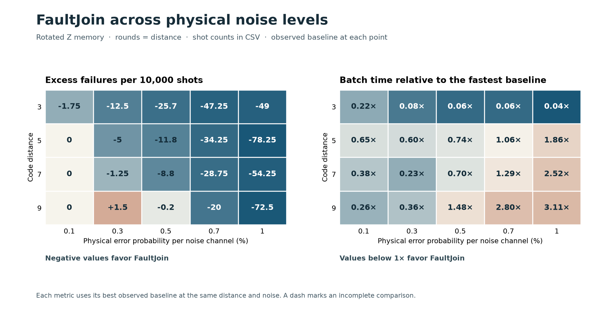

# Syndrome Hunters · FaultJoin

FaultJoin predicts the logical flip of a rotated surface-code memory experiment from its detector clicks. It sums the probabilities of competing logical outcomes when the circuit is small. On larger circuits it uses two handwritten approximations, then sends ambiguous shots to correlated PyMatching. The decoder builds its tables from the supplied Stim detector error model (DEM). It uses the same settings across code distances, bases, round counts and physical error rates.

## Results at 0.5% physical noise

Each cell gives the **logical failure rate / batch time in microseconds per shot**. All four decoders saw identical rotated Z-memory experiments, with 100,000 shots at each distance and as many measurement rounds as the distance.

| Distance | FaultJoin | PyMatching | Correlated PyMatching | Weighted union–find |
|---:|---:|---:|---:|---:|
| 3 | **1.434% / 0.034** | 1.721% / 0.557 | 1.691% / 1.369 | 1.807% / 1.030 |
| 5 | **0.932% / 2.45** | 1.399% / 3.33 | 1.050% / 9.42 | 1.563% / 10.16 |
| 7 | **0.507% / 9.34** | 1.003% / 13.36 | 0.595% / 31.86 | 1.221% / 40.96 |
| 9 | 0.318% / 46.28 | 0.700% / **31.17** | 0.320% / 87.81 | 0.883% / 99.76 |

At distances 5 and 7, FaultJoin reduced failures by **11.2% and 14.8%** relative to correlated PyMatching. On the shots where the two decoders disagreed, two-sided exact McNemar tests gave p-values of 1.17 × 10⁻⁸ and 2.42 × 10⁻⁶. FaultJoin also used 26% and 30% less batch time than ordinary PyMatching. At distance 9, the paired test could not distinguish 318 failures from 320 (p = 0.94), and ordinary PyMatching was faster. [Confirmatory CSV and run manifest](results/confirm)


## What changes across distances and noise levels

The three sweeps cover **1.29 million distinct memory experiments at 25 operating points**. Each point pairs all four decoders on the same sampled arrays. Across the 25 points, FaultJoin recorded fewer failures than every comparator at 20 points, tied for the fewest at three and had more at two. It had the fastest batch time at 17 points. At low noise, a difference of a few observed failures can change the ranking. These totals describe the sampled grid.

| Held-out sweep | Points | Fewest failures, outright | Tied for fewest | Fastest batch time |
|---|---:|---:|---:|---:|
| Z memory, 0.5% noise, 100,000 shots per point | 4 | 4 | 0 | 3 |
| Z memory, 0.1%, 0.3%, 0.7%, 1.0% noise, 40,000 per point | 16 | 12 | 3 | 10 |
| X memory, five rounds, 0.5% noise, 50,000 per point | 5 | 4 | 0 | 4 |



- **High-noise cost.** At 1% physical noise and distance 7, FaultJoin made 3,071 errors in 40,000 shots, compared with 3,288 for correlated PyMatching and 4,105 for ordinary PyMatching. Batch time was 74.15, 76.94 and 29.48 µs/shot, respectively. At distance 9 and 1% noise, FaultJoin took 250.10 µs/shot versus 230.09 for correlated matching and 80.31 for ordinary matching. [Noise sweep](results/noise) · [Failure-rate figure](figures/logical_error_rates.png)
- **Changing the circuit.** With X memory and a fixed five rounds, FaultJoin had both the fewest failures and the fastest batch time at distances 4, 5, 6 and 7. At distance 9, correlated matching made 106 errors versus FaultJoin's 114 (paired p = 0.34). The other point where correlated matching recorded fewer errors was Z memory at distance 9 and 0.3% noise, with 7 versus 13 (p = 0.15). [X-memory results](results/x_memory) · [Batch and single-shot timing](figures/runtime_scaling.png)
- **Compared with the previous FaultJoin.** We reran the original `shahi_2` decoder on the 100,000-shot Z samples and verified identical sample hashes. At distance 5 the failure count fell from 1,292 to 932 and batch time from 6.76 to 2.45 µs/shot. At distance 7 it fell from 817 to 507 and from 21.44 to 9.34 µs/shot. Both metrics also improved at distances 3 and 9. To reproduce the original, run the confirmatory command from revision `0351fe0762bff5115e251009f13c62d665aa82a8` with `--decoders fault_join`. [Original-run data](results/original) · [Original source](https://github.com/ghostshahinul/syndrome_hunters_ecc/tree/0351fe0762bff5115e251009f13c62d665aa82a8)

## How the decoder works

1. **Compute the exact logical decision when the syndrome space fits.** Each independent DEM event flips a detector mask and a logical mask together. For one logical bit, the inverse Walsh–Hadamard transform of the signed characteristic function gives the difference between the probabilities of the two logical classes for every syndrome. Its sign selects the maximum-a-posteriori class. For several logical bits, FaultJoin transforms the joint distribution and picks the most probable logical word. GF(2) rank reduction limits the transform to 24 bits. Floating-point ties or unresolved entries defer to matching. At distance 3 in the reported Z experiment, the transform uses a 128 MiB work array during setup and retains a 16 MiB decision table. [Implementation](src/decoders/exact.py) · [Exhaustive fault-assignment tests](tests/test_fault_map.py)
2. **Sum likely corrections on the detector graph.** For a larger one-observable model, FaultJoin first recombines components of the same physical fault within each detector sector when their XOR is graphlike. It builds a graph with two copies of every active detector, one for each accumulated logical parity. A matrix inverse sums weighted walks between detectors and from each detector to a boundary. For an incoming syndrome, a bounded-width dynamic program adds the weights of pair and boundary explanations in each logical class. It accepts a decision when the approximate odds exceed 100 to 1. Shared edges, omitted pairs and inter-sector correlations make these odds approximate. [Sector projection](src/decoders/sectors.py) · [Walk sums and frontier algorithm](src/decoders/frontier.py)
3. **Use evidence from the other detector sector.** For ambiguous shots with at most 13 active clicks, each candidate edge uses up to seven nearby opposite-sector check outcomes. A local Walsh transform computes the joint parity probabilities, and the decoder clips the resulting edge odds. It sums shortest paths and pairings again with those updated weights. An absolute difference between the two logical masses greater than 65% of their sum accepts the prediction. Both confidence thresholds are tuning parameters. [Conditional path sums](src/decoders/soft_paths.py)
4. **Finish unresolved shots with correlated matching.** On this final route, correlated PyMatching receives the sector-recombined DEM, with each fault's centered odds scaled by 0.5 per nonempty component. This empirical adjustment changes only the fallback decision weights. Stim always samples the original physical circuit. Resource limits include seven simultaneous frontier sites and at most 1,024 active graph vertices for the walk calculation. Cases exceeding a stage's limits continue to a subsequent stage. [Decoder routing](src/decoders/experimental.py) · [PyMatching](https://github.com/oscarhiggott/PyMatching)

The exact decision rule minimizes expected logical error for the specified independent-fault DEM wherever the exact table resolves a syndrome. Larger-distance accuracy and runtime are empirical. Related work includes optimal surface-code decoding and the use of correlated syndrome evidence in belief-matching. [Bravyi, Suchara and Vargo](https://arxiv.org/abs/1405.4883) · [Higgott et al.](https://arxiv.org/abs/2203.04948)

## Run the decoder and reproduce the benchmarks

Use Python 3.12 in a virtual environment. On Windows, run `py -3.12 -m venv .venv` then `.\.venv\Scripts\Activate.ps1`. On Linux or macOS, use `python3.12 -m venv .venv` then `source .venv/bin/activate`.

```sh
python -m pip install -e ".[dev]"
python -m pytest -q
```

For a judge supplying bit-packed detector shots and a graphlike decomposed Stim DEM, the command writes one logical prediction per shot into a new file.

```sh
python -m src.decode --dem circuit.dem --dets shots.b8 --out predicted.b8
```

In Python, construct the decoder once per circuit and reuse it across batches.

```python
from src.circuits import detector_error_model, surface_code_circuit
from src.decoders.experimental import FaultJoinDecoder

circuit = surface_code_circuit(distance=7, p=0.005, rounds=7, basis="z")
decoder = FaultJoinDecoder(detector_error_model(circuit))
dets, truth = circuit.compile_detector_sampler(seed=123).sample(
    4096, separate_observables=True
)
predicted = decoder.decode_batch(dets)
logical_error_rate = (predicted != truth).any(axis=1).mean()
```

These commands reproduce the three evaluation designs. For comparable CPU timing, set `OPENBLAS_NUM_THREADS=1` before running Python (`$env:OPENBLAS_NUM_THREADS = '1'` in PowerShell).

```sh
python -m src.evaluate --distances 3 5 7 9 --ps .005 --shots 100000 --seed 9073101 --latency-shots 128 --out-dir results/confirm
python -m src.evaluate --distances 3 5 7 9 --ps .001 .003 .007 .01 --shots 40000 --seed 9073102 --latency-shots 64 --out-dir results/noise
python -m src.evaluate --basis x --rounds 5 --distances 4 5 6 7 9 --ps .005 --shots 50000 --seed 9073103 --latency-shots 64 --out-dir results/x_memory
python -m src.plots
```

The evaluator rotates decoder order between grid points. It reports the median of three warmed passes with batches of 4,096 shots, plus single-call p50 and p95, setup and warm-up time, Wilson intervals, and two-sided exact paired tests for failures. The reported p-values are per comparison. The batch numbers exclude simulation, setup and scoring. For example, FaultJoin setup took 0.42 s at distance 5, 1.49 s at distance 7 and 6.61 s at distance 9 in the confirmatory run. Reuse matters for short jobs. Memory readings in the CSV are Python-traced peaks for one warm batch and can miss native allocations.

`make data` archives bit-packed samples. Give `src.evaluate` the same sampling arguments and `--data-dir data` to reuse them. `make bench`, `make test` and `make plots` are also available. Each run writes a timestamped CSV and a JSON manifest with its seed, device environment and package versions. The CSV records a SHA-256 of the detector and observable arrays for each point. Stim's seeded sample stream can vary with version and machine SIMD capabilities. [Stim sampler documentation](https://github.com/quantumlib/Stim/blob/main/doc/python_api_reference_vDev.md#stimcircuitcompile_detector_sampler)
