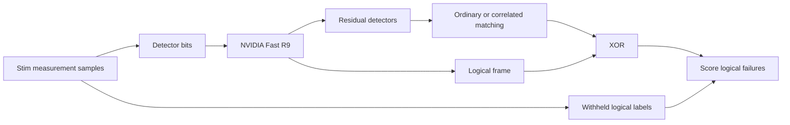

# NVIDIA Ising hybrid decoder

The experiment pairs NVIDIA Fast R9 with two global decoders. One runs ordinary PyMatching, following NVIDIA's reference. The other uses the project's two-pass correlated PyMatching on the same residual. Both produce one logical prediction per shot. The existing evaluator also runs FaultJoin, ordinary and correlated PyMatching, and weighted union–find on the same detector rows. [Hybrid implementation](../src/decoders/ising.py) · [NVIDIA reference inference](https://github.com/NVIDIA/Ising-Decoding/blob/4e5ef40494d13842aeee6cdf735b4d3134286dfa/code/evaluation/logical_error_rate.py) · [Research paper](https://arxiv.org/abs/2604.12841)



## Circuit compatibility

We selected approach B and generated the shared experiment with NVIDIA's Stim circuit. For both X and Z memory, the two generators produce 24, 120, 336 and 720 detector bits at distances 3, 5, 7 and 9 with rounds equal to distance. Each has a single observable, L0. At all eight settings, the noiseless gate schedules, ordered detector parities, observable measurement records and detector error models differ. The project's generated Stim circuits annotate every detector with coordinates. NVIDIA's circuit encodes geometry through its schedule and XV stabilizer maps. [Machine-readable comparison](../results/ising/circuit_audit.json)

For example, at Z distance 3 and p = 0.005, the project's logical observable uses final measurement offsets −7, −8 and −9. NVIDIA uses −9, −6 and −3. The decomposed error models have 286 and 232 error instructions respectively. Exporting a legacy NPZ as a NVIDIA detector file would assign different meanings to its columns.

NVIDIA's public orientation O1 is XV. Its default 25-channel vector at p = 0.003 is reproduced by `NoiseModel.from_single_p`. Each sweep point constructs its own vector. The preparation and measurement flip rates are 2p/3, each idle Pauli component during a CNOT layer has probability p/3, and each nonidentity two-qubit CNOT Pauli has probability p/15. The effective SPAM-window idle probability per Pauli is 2p/3 − 4p²/9. The older generator sets its four Stim noise knobs to p. The model was trained at d = T = 9. NVIDIA reports results from d = 9 upward for its noise distribution. Treat d = 3, 5 and 7 as exploratory when running Fast R9. The nominal noise sweep tests this public family at five settings. [Public configuration](https://github.com/NVIDIA/Ising-Decoding/blob/4e5ef40494d13842aeee6cdf735b4d3134286dfa/conf/config_public.yaml) · [Fast R9 model card](https://huggingface.co/nvidia/Ising-Decoder-SurfaceCode-1-Fast)

## Sampling and correction semantics

1. Construct NVIDIA's `MemoryCircuit` with its 25-channel noise model, XV orientation and terminal boundary detectors. Build the graphlike DEM with `decompose_errors=True` and `approximate_disjoint_errors=True`, as upstream does.
2. Seed Stim's measurement sampler and convert the resulting measurements to detector bits and observable flips with the same circuit. Write and reload NVIDIA's `samples_Z.dets` and `metadata_Z.json` pair. The cache verifies the source revision, Stim version, circuit and DEM hashes, all 25 noise probabilities and their fingerprint, seed, dimensions, basis, and a SHA-256 over the packed detector and label matrices. Keep the ignored `data/ising` directory to replay the exact shots across machines. Stim's seeded simulation can vary with its version, SIMD width and sampling call shape. [Data implementation](../src/ising_data.py) · [NVIDIA generator](https://github.com/NVIDIA/Ising-Decoding/blob/4e5ef40494d13842aeee6cdf735b4d3134286dfa/code/export/generate_test_data.py)
3. Send only the detector matrix to the official `PreDecoderMemoryEvalModule`. It builds the space–time input, thresholds the four correction channels, and returns the predecoder logical frame in column zero followed by residual detectors in NVIDIA's original order.
4. Decode the residual with a matcher constructed from the original DEM. The final prediction is `pre_L XOR matching(residual)`. The official saved residual array alone lacks the frame. The adapter captures both pieces from the live module. Correlated matching reuses the original fault priors as a heuristic for a changed residual distribution. The paired LER comparison measures whether that choice helps.
5. Score a shot as a failure if any predicted observable differs from Stim's withheld label. The evaluator writes raw discordant counts and two-sided exact McNemar/binomial p-values against both ordinary and correlated matching. Wilson intervals are per operating point. The tests flip all labels and check that all six decoders keep the same predictions. [Evaluator](../src/evaluate.py) · [Validation](../tests/test_ising.py)

The official transform masks the last complementary-check block in its neural input and residual arithmetic. It copies the final measurement-basis boundary detectors from the original input. Single-detector probes in both bases verify this convention and the frame of a known correction. A change in residual density thus includes upstream boundary handling. Both hybrids use the published transform. [NVIDIA input and boundary indexing](https://github.com/NVIDIA/Ising-Decoding/blob/4e5ef40494d13842aeee6cdf735b4d3134286dfa/code/data/predecoder_transform.py)

### Experimental boundary restoration

An additional decoder, `ising_boundary_correlated`, restores the original input contribution to that block after the CNN. For Z memory with d = T = 9 the block is D600–D639. In the 10,000-shot p = 0.005 sample, it contained 22,174 recorded clicks across 8,219 shots. The variant XORs those detector bits into the published residual. This preserves the predicted local correction on those columns, the predecoder's logical frame and the original measurement-basis terminal boundary. It then applies correlated matching to the original DEM. Both requested reference hybrids retain NVIDIA's exact output. [Implementation](../src/decoders/ising.py)

### Compiling the distance-3 hybrid

`ising_boundary_table` evaluates the boundary-restored hybrid at initialization for every attainable input, using the real checkpoint and the circuit's correlated matcher. It obtains the active coordinates from the DEM's full fault signatures and checks their rank over GF(2). With d = T = 3, all 20 active columns are independent, so there are 1,048,576 input patterns. The compiler enumerates them in fixed batches of 64. Its tables store the resulting logical bit and residual event count. Online decoding on the CPU packs the observed active detectors into a table index. An off-support input goes to the original streaming decoder.

Compilation uses the circuit and model alone and finishes before the first benchmark shot. `table_build_s` is included in `init_s`. For on-support shots, `decode_s` measures the CPU lookup and the separately timed inference and matching stages are zero. Larger grids have 108, 312 and 680 independent bits at distances 5, 7 and 9 respectively. The explicit 20-bit limit bounds the exponential setup cost. A table belongs to a particular DEM, model and inference precision. [Exhaustive compiler](../src/decoders/ising_table.py)

At p = 0.005 on 50,000 shots, the optimized CPU lookup and streaming GPU hybrid had the same prediction SHA-256, the same 998 logical failures, and the same 17,009 residual events. The 2 MiB table took 166.61 s to build on CUDA, with 20.3 MiB of peak GPU allocations. The CPU lookup reached 10.01 million shots/s, or 0.100 µs/shot in batches of 64. Its single-shot p50/p95 was 2.9/3.3 µs. The streaming hybrid used 228.155 µs/shot and correlated PyMatching used 2.199 µs/shot. Correlated matching had 955 failures (paired p = 0.0709). Including initialization and warm-up, the first lookup pass took 167.66 s. At these warmed rates, amortizing setup against correlated matching would require about 80 million shots for this circuit. The earlier NumPy lookup gave identical predictions at 0.662 µs/shot. [Optimized comparison](../results/ising/lookup/bench_20261122T003142611999Z.csv) · [Initial CPU lookup](../results/ising/lookup/bench_20261122T001827531766Z.csv)

```powershell
$py = ".\.venv-ising\Scripts\python.exe"
& $py -m src.evaluate --source nvidia --decoders pymatching pymatching_correlated fault_join ising_boundary_correlated ising_boundary_table --distances 3 --ps 0.005 --shots 50000 --batch-size 64 --device cuda --precision fp32 --repeats 3 --latency-shots 128 --out-dir results/ising/lookup
& $py -m src.evaluate --source nvidia --decoders pymatching pymatching_correlated fault_join ising_boundary_correlated ising_boundary_table --distances 3 --ps 0.001 --shots 100000 --seed 20261123 --batch-size 64 --device cuda --precision fp32 --repeats 3 --latency-shots 128 --out-dir results/ising/lookup-holdout
$heldOutCsv = (Get-ChildItem results/ising/lookup-holdout/*.csv | Sort-Object Name | Select-Object -Last 1).FullName
& $py -m src.plots $heldOutCsv --tradeoff-only --out-dir figures/ising-lookup
```

For blind decoding, construct the decoder once and supply detector-only shots in this exact circuit order.

```python
from src.ising_data import experiment
from src.decoders.ising import IsingHybrid

exp = experiment(distance=9, rounds=9, p=0.005, basis="z")
decoder = IsingHybrid.from_experiment("ising_boundary_correlated", exp, device="auto", precision="fp32")
predictions = decoder.decode_batch(detector_bits)  # bool (shots, 720) -> bool (shots, 1)
```

## Install in an isolated environment

These PowerShell commands run from the project root on Windows 11. The clone, virtual environment, sample cache and model weights are Git-ignored. The project keeps its original classical dependencies. Run the clone and checkout commands only for a fresh external source directory.

```powershell
py -3.12 -m venv .venv-ising
$py = ".\.venv-ising\Scripts\python.exe"
git clone https://github.com/NVIDIA/Ising-Decoding.git external/Ising-Decoding
git -C external/Ising-Decoding checkout --detach 4e5ef40494d13842aeee6cdf735b4d3134286dfa
& $py -m pip install --index-url https://download.pytorch.org/whl/cu128 torch==2.9.1
& $py -m pip install -c requirements-ising-constraints.txt -r external/Ising-Decoding/code/requirements_public_inference.txt -e ".[dev]" huggingface_hub
```

The native Windows adapter sets `TORCH_COMPILE_DISABLE=1` and `PREDECODER_TORCH_COMPILE=0` before loading NVIDIA's modules. The CUDA wheel can also run CPU inference. For a CPU-only installation, use the PyTorch CPU index in place of the CUDA index. Under WSL2/Linux, use `python3.12 -m venv .venv-ising` and `.venv-ising/bin/python` for the same module commands. [NVIDIA installation guide](https://github.com/NVIDIA/Ising-Decoding/tree/4e5ef40494d13842aeee6cdf735b4d3134286dfa#installation) · [PyTorch wheels](https://pytorch.org/get-started/previous-versions/)

The Hugging Face client retrieved the checkpoint on this laptop. The downloader requests the pinned revision and verifies its official LFS SHA-256. On a fresh machine, if Hugging Face returns HTTP 401 or 403, sign in on the model page, accept its access conditions, run `.\.venv-ising\Scripts\hf.exe auth login`, and repeat the download. The CLI stores the credential outside the repository. An authorized browser download also works when saved as `external/models/ising_decoder_surface_code_1_fast_r9_v1.0.77_fp16.safetensors`. [Model access and files](https://huggingface.co/nvidia/Ising-Decoder-SurfaceCode-1-Fast)

```powershell
& $py -m src.ising_data download
& $py -m src.ising_data doctor
& $py -m pytest -q
```

| Artifact | Identifier |
|---|---|
| Fast R9 model revision | `77b3a3f444612afe838fa0ece526b4c588541576` |
| File | `ising_decoder_surface_code_1_fast_r9_v1.0.77_fp16.safetensors` |
| File SHA-256 | `22db7ad25b584d7588493d6ef815381c8d1263cfb29f212391a591b285ad0a05` |
| Inference | Threshold logits at zero, NVIDIA's channels-last 3D layout, CUDA fp16 or fp32, CPU fp32 |

Hugging Face publishes the file digest in the model revision API's `siblings[].lfs.sha256` field. A live query for the revision above returned the same SHA-256 as the local checkpoint and the user-supplied checksum. Both the Hub entry and the local file measured 1,826,360 bytes. The verification record identifies the exact revision, filename, metadata field, and both digests. [Official revision metadata](https://huggingface.co/api/models/nvidia/Ising-Decoder-SurfaceCode-1-Fast/revision/77b3a3f444612afe838fa0ece526b4c588541576?blobs=true) · [Local verification record](../results/ising/fast_r9_verification.json)

## Run the comparisons

Use the same seed, basis and shot count for replay. Each invocation writes a fresh timestamped CSV/JSON pair. For a quick compatibility audit use `& $py -m src.ising_data audit`.

```powershell
$six = "pymatching","pymatching_correlated","fault_join","union_find","ising_pymatching","ising_pymatching_correlated"
$sweep = $six + "ising_boundary_correlated"
& $py -m src.evaluate --source nvidia --decoders $six --distances 3 --ps 0.005 --shots 1000 --batch-size 8 --device cuda --precision fp16 --repeats 1 --latency-shots 32 --out-dir results/ising/hybrid-smoke
& $py -m src.evaluate --source nvidia --decoders $six --distances 9 --ps 0.005 --shots 1000 --batch-size 8 --device cpu --precision fp32 --repeats 1 --latency-shots 32 --out-dir results/ising/hybrid-cpu
& $py -m src.evaluate --source nvidia --decoders $six --distances 9 --ps 0.005 --shots 1000 --batch-size 8 --device cuda --precision fp16 --repeats 1 --latency-shots 32 --out-dir results/ising/hybrid-gpu
& $py -m src.evaluate --source nvidia --decoders $sweep --distances 3 5 7 9 --shots 10000 --batch-size 64 --device cuda --precision fp32 --repeats 1 --latency-shots 32 --out-dir results/ising/hybrid-preliminary
& $py -m src.evaluate --source nvidia --decoders $sweep --distances 3 5 7 9 --shots 50000 --batch-size 64 --device cuda --precision fp32 --repeats 1 --latency-shots 64 --out-dir results/ising/hybrid-final
& $py -m src.evaluate --source nvidia --decoders $sweep --basis x --distances 9 --ps 0.005 --shots 1000 --seed 20261122 --batch-size 64 --device cuda --precision fp32 --repeats 1 --latency-shots 16 --out-dir results/ising/x-smoke
$csv = (Get-ChildItem results/ising/hybrid-final/*.csv | Sort-Object Name | Select-Object -Last 1).FullName
& $py -m src.plots $csv --out-dir figures/ising-hybrid
```

The default five noise values are 0.001, 0.003, 0.005, 0.007 and 0.01. The default seed is 20261121. The default basis is Z and the default round count is the distance. A device of `auto` selects CUDA when available and CPU otherwise. The detector-cache key excludes device and decoder, so CPU/GPU profiles reuse the archived samples.

Smoke, preliminary and final protocols reuse the specified seed with different shot counts. Results and intervals are reported separately for each protocol. At each final point all seven entrants see exactly one archived file. Batch-size and precision selection used runtime and prediction stability on the 1,000-shot profile. The benchmark performs one warmed end-to-end pass over each 50,000-shot sample for the seven-way grid, plus 64 individually timed calls. The separate classical controls use three passes at batch 512. Use the seven-way table when comparing AI and classical speed at a common batch size.

To reproduce the classical controls without weights, the original project environment needs only the pinned NVIDIA source checkout. The following commands reproduce the smoke, preliminary and final protocols.

```powershell
$classical = ".\.venv\Scripts\python.exe"
& $classical -m src.evaluate --source nvidia --distances 3 --ps 0.005 --shots 1000 --batch-size 512 --repeats 3 --latency-shots 64 --out-dir results/ising/smoke
& $classical -m src.evaluate --source nvidia --distances 3 5 7 9 --shots 10000 --batch-size 512 --repeats 1 --latency-shots 64 --out-dir results/ising/preliminary
& $classical -m src.evaluate --source nvidia --distances 3 5 7 9 --shots 50000 --batch-size 512 --repeats 3 --latency-shots 128 --out-dir results/ising/final
$csv = (Get-ChildItem results/ising/final/*.csv | Sort-Object Name | Select-Object -Last 1).FullName
& $classical -m src.plots $csv --out-dir figures/ising-classical
```

## Interpret runtime and profile the hybrid

`init_s` includes decoder construction and model loading. `model_load_s` isolates checkpoint deserialization, weight placement and precision conversion. `warmup_s` is separate. The median warmed batch pass yields `decode_s` and shots/s. On CUDA, timing synchronizes the device. `ai_s` includes packing, transfers, inference and residual construction. `global_s` covers residual matching and frame composition. Single-call p50/p95 use one syndrome per call. Peak CUDA memory is PyTorch allocated memory including resident model weights. The separate Python-traced peak excludes native allocations. The timed path excludes simulation, cache I/O, scoring and downloading.

The profiling command compares the same distance-9 shots across CPU fp32, CUDA fp32/fp16 and batch sizes 8, 64 and 128. Each manifest records whether the complete logical predictions match the first variant for each decoder. Numerical changes near the correction threshold can change predictions. The single-shot measurements capture interactive latency, and `global_s` isolates the residual matching stage.

```powershell
& $py -m src.ising_profile --distance 9 --p 0.005 --shots 1000 --devices cuda cpu --batch-sizes 8 64 128 --repeats 1 --latency-shots 8
```

The density fields use the number of detector bits across all shots as their denominator. The reduction factor is input events divided by residual events. Percent removed is 100 times the decrease divided by input events. A zero denominator yields an empty field. The figure generator creates a density comparison only for measured residuals. The accuracy–runtime plot uses final logical predictions.

## Local device and precision measurements

### Classical controls

This independent Z-memory run used 50,000 shots per point, batch 512 and the median of three warmed passes. At p = 0.005 the entries are LER / batch microseconds per shot. The seven-decoder comparison uses the same archives and its own common batch size.

| Distance | FaultJoin | Ordinary PyMatching | Correlated PyMatching | Weighted union–find |
|---:|---:|---:|---:|---:|
| 3 | 1.750% / 0.78 | 2.074% / 0.59 | 1.910% / 1.83 | 2.888% / 1.34 |
| 5 | 1.820% / 6.93 | 2.164% / 4.30 | 1.488% / 11.99 | 2.488% / 12.99 |
| 7 | 1.248% / 27.08 | 1.826% / 17.95 | 0.960% / 73.21 | 2.118% / 68.87 |
| 9 | 0.816% / 85.69 | 1.188% / 58.76 | 0.530% / 125.89 | 1.512% / 149.91 |

At d = 3, FaultJoin corrected 230 shots missed by correlated matching and missed 150 that correlated matching corrected (paired p = 0.0000477). At d = 9 the counts were 115 and 258 (p = 9.73 × 10⁻¹⁴). The final sweep contained one million shot trials. [Final classical CSV](../results/ising/final/bench_20261121T231401861609Z.csv) · [Smoke CSV](../results/ising/smoke/bench_20261121T230231273583Z.csv) · [Preliminary CSV](../results/ising/preliminary/bench_20261121T230340792187Z.csv) · [Classical trade-off figure](../figures/ising-classical/accuracy_runtime.png)

### Fast R9 on CPU and GPU

The six-decoder smoke test used 1,000 Z-memory shots at d = 3, p = 0.005 and seed 20261121. Ordinary matching, correlated matching, FaultJoin and union–find missed 17, 16, 14 and 22 shots respectively. The published Ising pipeline missed 15 and Ising with correlated matching missed 16. All six rows have the same sample SHA-256. [Smoke CSV](../results/ising/hybrid-smoke/bench_20261121T231851290228Z.csv) · [Seven-decoder preliminary grid](../results/ising/hybrid-preliminary/bench_20261121T233047900726Z.csv)

Fast R9 loaded and ran on both the Intel Core i7-10750H and the GTX 1650 Ti. This Windows 11 laptop had no WSL installation. Python 3.12.10, PyTorch 2.9.1+cu128 and NVIDIA driver 610.88 ran native inference. PyTorch detected compute capability 7.5 and approximately 4 GiB of GPU memory. Known-answer 3D convolutions passed on CPU fp32 and CUDA fp32/fp16. [Environment and checkpoint verification](../results/ising/environment.json)

The table reports end-to-end time for Ising plus correlated matching on the same 1,000 distance-9, Z-memory shots at p = 0.005. Each value is microseconds per shot from one warmed pass. These are hardware-specific tuning measurements.

| Inference device and precision | Batch 8 | Batch 64 | Batch 128 |
|---|---:|---:|---:|
| GTX 1650 Ti, fp32 | 1,322 | **1,073** | 1,290 |
| GTX 1650 Ti, fp16 | 5,575 | 5,244 | 5,048 |
| CPU, fp32 | 12,389 | 12,154 | 11,301 |

At batch 64, CUDA fp32 used 109.9 MiB of peak PyTorch allocations and CUDA fp16 used 37.4 MiB. At this operating point all nine variants produced identical logical predictions for each matcher. The raw input contained 53,938 events. The fp32 predecoder returned 2,562 events and fp16 returned 2,565. Ordinary and correlated hybrid predictions missed 18 and 17 shots respectively, compared with 6 for classical correlated matching. The larger sweep uses CUDA fp32 and batch 64. [GPU fp32 measurement](../results/ising/profile/bench_20261121T231935037174Z.csv) · [GPU fp16 measurement](../results/ising/profile/bench_20261121T232003195595Z.csv) · [CPU measurement](../results/ising/profile/bench_20261121T232111720247Z.csv)

## Final results and boundary ablation

The seven-way Z-memory grid covered 20 configurations and 50,000 shots per point. All 140 sample hashes matched the archived detector and logical arrays at their respective points. All 80 classical failure counts reproduced the independent batch-512 control run. The tests also compare our standard hybrid directly with NVIDIA's offline evaluation runner on the real checkpoint, including its saved residual detectors, logical predictions and truth arrays. [Final CSV](../results/ising/hybrid-final/bench_20261122T001433622270Z.csv) · [Manifest and Wilson intervals](../results/ising/hybrid-final/bench_20261122T001433622270Z.json) · [Reference-run test](../tests/test_ising.py)

At distance 9, p = 0.005, the raw input filled 7.541% of detector bits. The two published-residual hybrids reduced this to 0.369% (20.44×). Restoring the complementary checks gave 0.589% (12.81×). Ordinary PyMatching on the raw syndrome had 594 logical failures and correlated matching had 265. The boundary-restored hybrid corrected 116 shots missed by correlated matching and missed 396 shots that correlated matching got right (two-sided paired p = 8.49 × 10⁻³⁷). [Measured density](../figures/ising-hybrid/syndrome_density.png) · [Logical error rate versus runtime](../figures/ising-hybrid/accuracy_runtime.png)

| Distance 9, p = 0.005 | Failures / 50,000 | LER (95% Wilson) | AI stage (s) | Global stage (s) | Total (s) | Single p50 / p95 (ms) |
|---|---:|---:|---:|---:|---:|---:|
| Raw correlated PyMatching | 265 | 0.530% (0.470–0.598%) | — | 10.008 | 10.008 | 0.168 / 0.291 |
| Fast R9 + ordinary matching | 568 | 1.136% (1.047–1.233%) | 80.056 | 5.658 | 85.762 | 12.031 / 17.266 |
| Fast R9 + correlated matching | 551 | 1.102% (1.014–1.197%) | 82.488 | 15.157 | 97.705 | 16.731 / 179.926 |
| Restored boundary + correlated matching | 545 | 1.090% (1.003–1.185%) | 76.746 | 6.863 | 83.650 | 12.248 / 13.210 |

The times are full-pass totals on the laptop. The boundary-restored variant spent 92% of its warmed decoding time in the predecoder stage, including transfers and residual construction. Its setup took 0.252 s, including 0.106 s of model loading, followed by 0.185 s of warm-up. The GPU peak was 109.8 MiB. Per-call latency has greater measurement variability than a 50,000-shot throughput pass. [Stage measurements and single-call timing](../results/ising/hybrid-final/bench_20261122T001433622270Z.csv)

At distance 3 and p = 0.001, each streaming hybrid made 52 errors versus 85 for correlated matching, with 49 reference-only errors and 16 hybrid-only errors (paired p = 0.0000508). At d = 5 and the same p, the one-error difference had paired p = 1.0. In the four distance-9 settings from p = 0.003 through 0.01, raw correlated matching had fewer errors than every hybrid. At d = 9, p = 0.001, the decoders observed only 0–2 failures each. These counts support pointwise comparisons. Estimating an asymptotic threshold or extrapolating absolute GPU timings would require additional distances, shots and hardware. [Noise sweep with confidence intervals](../figures/ising-hybrid/logical_error_rates.png)

### Fresh distance-9 run after checkpoint verification

After comparing the local checkpoint bytes with Hugging Face's published LFS SHA-256, we reran the full suite and all eight circuit audits. All 70 tests passed, including real CPU and CUDA inference and equality with NVIDIA's offline reference arrays. The eight audited layouts matched the archived circuit audit. A new Z-memory benchmark used 50,000 shared shots at distance 9, nine rounds, p = 0.005, seed 20261125, and CUDA fp32 in batches of 64. The SHA-256 of the packed detector and observable arrays was `504294b118d66b9b5acb1d806164b052dccda51be1474bc793af8e0835390c3e`. Re-reading the Stim file reproduced that digest for all seven rows and confirmed that this sample differed from the main grid's seed. [Checkpoint comparison](../results/ising/fast_r9_verification.json) · [Benchmark CSV](../results/ising/checkpoint-recheck/bench_20261122T004006068498Z.csv) · [Run manifest](../results/ising/checkpoint-recheck/bench_20261122T004006068498Z.json)

The boundary-restored hybrid missed 516 shots (1.032%) and took 1,345.6 µs/shot. Ordinary matching missed 639 (1.278%), FaultJoin missed 386 (0.772%) and correlated matching missed 282 (0.564%). The boundary-restored hybrid correctly decoded 140 shots missed by correlated matching and missed 374 that correlated matching decoded correctly (paired p = 1.24 × 10⁻²⁵). It removed 92.18% of input detector events. [Measured accuracy and runtime](../figures/ising-checkpoint-recheck/accuracy_runtime.png)

```powershell
& $py -m src.evaluate --source nvidia --decoders $sweep --basis z --distances 9 --rounds 9 --ps 0.005 --shots 50000 --seed 20261125 --batch-size 64 --repeats 1 --latency-shots 64 --device cuda --precision fp32 --out-dir results/ising/checkpoint-recheck
```

### Independent low-noise comparison

After the seven-way grid identified a distance-3 advantage at p = 0.001, we evaluated the frozen hybrid on seed 20261123 with 100,000 fresh Z-memory shots. The first lookup used NumPy array packing. We subsequently fused index construction, the table reads and off-support detection into one Numba loop. The change affected the CPU implementation only. Both lookup versions reproduced the streaming decoder's complete prediction hash and its 6,796 residual events. The table builder receives only the DEM and pretrained decoder. [Initial lookup measurements](../results/ising/lookup-holdout/bench_20261122T002235273463Z.csv) · [Optimized comparison](../results/ising/lookup-holdout/bench_20261122T002805003139Z.csv)

| Decoder | Errors / 100,000 | LER | Batch µs/shot | Single p50 / p95 (µs) |
|---|---:|---:|---:|---:|
| Ordinary PyMatching | 96 | 0.096% | 0.306 | 13.4 / 23.5 |
| Correlated PyMatching | 137 | 0.137% | 0.600 | 11.8 / 20.8 |
| FaultJoin | 88 | 0.088% | 0.846 | 2.7 / 3.1 |
| Streaming boundary-restored hybrid | 94 | 0.094% | 113.804 | 5,758 / 11,118 |
| Compiled boundary-restored hybrid | 94 | 0.094% | **0.094** | 3.2 / 5.8 |

The hybrid's Wilson interval was 0.0768–0.1150%, compared with 0.1159–0.1619% for correlated matching. On the same shots, 68 favored the hybrid and 25 favored correlated matching (two-sided paired p = 9.38 × 10⁻⁶). The lookup delivered 10.68 million shots/s on the CPU after a 164.18 s GPU build. The first 100,000-shot pass cost 164.36 s including setup and warm-up, versus 0.062 s for correlated matching. Sustaining these measured rates in one process would amortize setup after approximately 325 million shots. This estimate applies to one circuit and noise setting. [Held-out trade-off figure](../figures/ising-lookup/accuracy_runtime.png) · [Full timing manifest](../results/ising/lookup-holdout/bench_20261122T002805003139Z.json)

### X-memory cross-check

An independent 1,000-shot X-memory check at distance 9, p = 0.005 and seed 20261122 exercised the same seven production entry points. Ordinary matching, correlated matching, FaultJoin and weighted union–find recorded 16, 9, 14 and 18 failures. The ordinary Ising hybrid, correlated Ising hybrid and boundary-restored hybrid recorded 17, 16 and 15. The larger sweep above uses Z memory. [X-memory results](../results/ising/x-smoke/bench_20261122T002301604935Z.csv)

## Validation

The full suite passed all **70 tests** in the isolated Ising environment, including real pretrained CPU/CUDA inference and a direct comparison with NVIDIA's offline runner. The classical environment passed **62 tests** and skipped eight optional upstream-inference tests. Across both runs there were zero failures. The verification includes detector-file round trips, shape and dtype, metadata corruption, known local corrections, logical-frame XOR, the effect of flipping the withheld truth labels, and exhaustive toy lookup decisions. Both real distance-3 lookup measurements reproduced the complete streaming prediction hashes. [Regression tests](../tests/test_ising.py)

## Next optimization

Persist the validated 2 MiB decision table so repeated judge runs for the same circuit can reuse the GPU compilation. Key it by circuit and DEM hashes, basis, source and checkpoint revisions, boundary rule, inference backend and precision. Verify the stored table checksum and measure cold loading against a fresh build. At distance 9 the profiled CNN stage dominates runtime, and raw correlated matching already wins on both main metrics at p = 0.005. A separate experiment could dispatch only selected syndromes to Fast R9, using detector-only features and a held-out seed to evaluate the rule.

## Project files

| Change | Files |
|---|---|
| New circuit adapter, source and checkpoint checks, offline I/O and hardware probe | [src/ising_data.py](../src/ising_data.py) |
| New streaming hybrid decoders and finite decision-table compiler | [src/decoders/ising.py](../src/decoders/ising.py) · [src/decoders/ising_table.py](../src/decoders/ising_table.py) |
| New CPU/GPU and precision profiling command | [src/ising_profile.py](../src/ising_profile.py) |
| Shared sample hashes, paired benchmarking and measured figures | [src/data.py](../src/data.py) · [src/evaluate.py](../src/evaluate.py) · [src/plots.py](../src/plots.py) |
| Regression, known-correction and official pretrained offline tests | [tests/test_ising.py](../tests/test_ising.py) |
| Isolated package constraints and local artifact exclusions | [requirements-ising-constraints.txt](../requirements-ising-constraints.txt) · [.gitignore](../.gitignore) |
| Run instructions, results and figures | [README](../README.md) · [benchmark artifacts](../results/ising/) · [figures](../figures/) |
